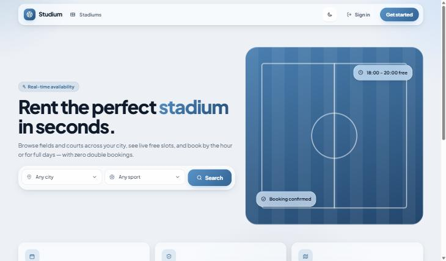
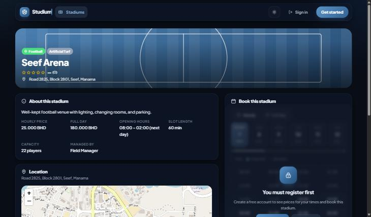
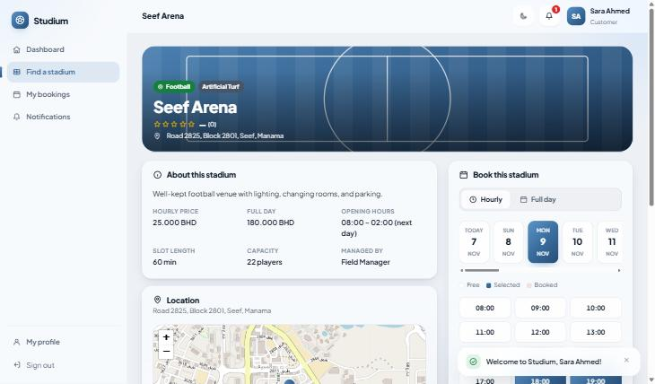
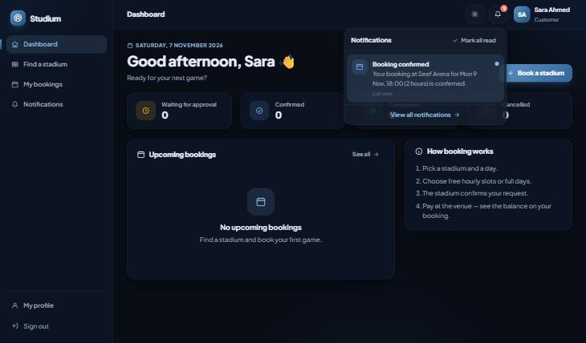
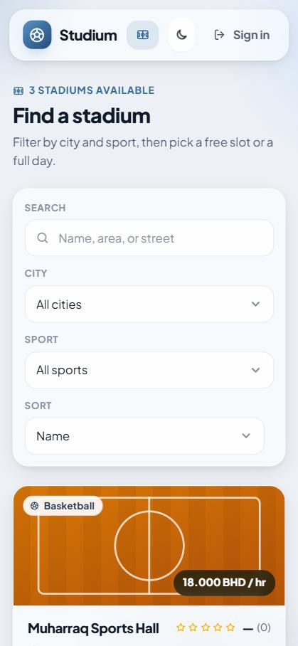

# Studium — stadium rentals

**Live: <https://studium-bh.infinityfreeapp.com>**

Rent football fields, courts, and halls by the hour or for full days. Customers see live availability and book without double bookings; managers run their stadiums, payments, and expenses; admins manage users, cities, settings, and role permissions.

Plain PHP 8.2 + MySQL (XAMPP), vanilla CSS and JavaScript. Full documentation (models, services, endpoints, use cases, phases, test report): [studium_reservation_management_docs](https://github.com/HussainALAradi5/studium_reservation_management_docs).

## Screenshots

| Landing (light) | Stadium page, booking locked for guests (dark) |
| --- | --- |
|  |  |

| Booking a slot (signed in) | Notifications (dark) | Mobile |
| --- | --- | --- |
|  |  |  |

## Features

- Hourly or full-day rentals with a locked overlap check and free alternatives on conflict.
- Booking lifecycle: request, confirm, reject, cancel (with cutoff), reschedule, complete, expiry.
- Payments and refunds ledger, expenses, accounting report.
- In-app notifications (bell, unread badge, inbox).
- Reviews: members-only comments, one rating per customer per stadium after playing.
- Roles admin / manager / customer with an editable permission matrix and admin-tunable booking settings.
- Map location (Leaflet + OpenStreetMap) with Google Maps links.
- Dark / light mode, iOS / Android style wheel date picker, responsive layout.

## Run locally (XAMPP)

1. Clone into `C:\xampp\htdocs\studium_reservation_management` and start Apache and MySQL.
2. Copy `.env.example` to `.env`; set `DB_*` and a development `SEED_PASSWORD`.
3. Create the schema and demo data:

   ```bash
   C:\xampp\php\php.exe bin/migrate.php
   ```

   ```bash
   C:\xampp\php\php.exe bin/seed.php
   ```

4. Open <http://localhost/studium_reservation_management/>.

**Demo accounts (development seed only):** `admin`, `manager`, `customer` — password is your `SEED_PASSWORD`.

## Tests

```bash
C:\xampp\php\php.exe tests/run.php
```

```bash
bash tests/http/api-suite.sh
```

The unit runner needs no packages. The API suite needs Apache, MySQL, and the development seed.

## Deploy

1. Set production values in `.env` on the server: `APP_ENV=production`, `APP_DEBUG=false`, the host's `DB_*`, and `APP_TRUST_PROXY=true` when HTTPS is terminated by a proxy (InfinityFree, Cloudflare, Render).
2. Rebuild the CSS bundle after any CSS change (production serves `assets/build/app.min.css`):

   ```bash
   C:\xampp\php\php.exe bin/build-assets.php
   ```

3. Create the database:
   - **With a command line (VPS, Render, Docker):** `php bin/migrate.php` then `php bin/install.php` (default permissions, settings, and the first admin; safe to run again).
   - **Without a command line (InfinityFree, shared hosting):** run `php bin/export-sql.php --with-admin` locally, then import `deploy/studium-install.sql` into the host's empty database with phpMyAdmin. Delete the file afterwards; it contains the admin's password hash.
4. Upload the project (not `.env.example`, `deploy/`, `tests/`, `screenshots/`, `node_modules/`) so `index.php` and `.htaccess` sit in the web root, then create `.env` there.
5. Sign in as the admin and add cities, managers, and stadiums. Never run `bin/seed.php` in production (it refuses).

### How the live site was deployed (InfinityFree, free)

The live site runs on InfinityFree's free plan (PHP 8 + MySQL + Apache, no command line). To deploy an update or a fresh copy, from Git Bash in the project folder:

1. **Account:** at <https://dash.infinityfree.com> create a free hosting account (subdomain `studium-bh.infinityfreeapp.com`) and set PHP to 8.2+.
2. **Database:** *MySQL Databases* → create `studium` (becomes `if0_<id>_studium`; host shown there, e.g. `sql212.infinityfree.com`).
3. **Install SQL with your admin** (asks for the admin's name, username, email, phone, password):

   ```bash
   /c/xampp/php/php.exe bin/export-sql.php --with-admin
   ```

   Import `deploy/studium-install.sql` in *phpMyAdmin* → *Import* (13 tables), then delete the file:

   ```bash
   rm deploy/studium-install.sql
   ```

4. **Release package** (runtime files only):

   ```bash
   git archive --format=zip -o deploy/studium-site.zip HEAD -- . ':!tests' ':!screenshots' ':!.env.example' ':!README.md' ':!.gitattributes' ':!.gitignore' ':!bin/seed.php' ':!seeds'
   ```

5. **Upload:** *File Manager* → `htdocs` → delete the default files → upload the contents of the zip (including `.htaccess`), and create the folders `storage/logs`.
6. **Configure:** create `htdocs/.env` from `.env.example` with `APP_ENV=production`, `APP_DEBUG=false`, `APP_TRUST_PROXY=true`, and the `DB_*` values from step 2 (`DB_PASS` = the hosting account password shown on the MySQL page).
7. **Check:** open the site, sign in as the admin, and add cities, managers, and stadiums.

For an update, repeat steps 4–5 (overwrite the files, keep `.env`); if a release adds migrations, run their SQL from `migrations/` in phpMyAdmin.

## Known limitations

- The OpenStreetMap public tile server is for light traffic; set `MAP_TILE_URL` to a tile plan for heavy use.
- Notifications are in-app only (no email or SMS yet).
- No online payment provider; payments are recorded by staff.
